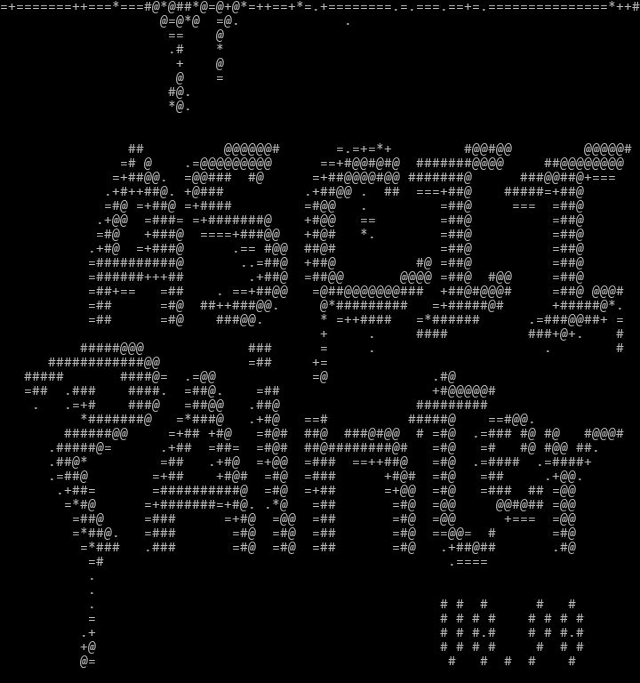

# ASCII Painter v0.92

A lightweight ASCII art painting tool: paint with a mouse on a grid of monospaced characters, using a palette that goes from light to dark. The interface is ASCII too, on purpose.

**For donations you can** [buy me a coffee here](https://ko-fi.com/msouza3d)! Thanks for supporting and using the app.
If you are from Brazil you can send me a donation using the PIX QR Code:<br>


**Author:** Marcelo Souza (@msouza3d)  
**Inspired by:** the work of [Vagon Parovoz](https://www.instagram.com/vagonparovoz/) and classic ANSI/ASCII art editors



---

## Overview

ASCII Painter is a standalone ASCII art editor built with **Python + Pygame + NumPy**.  
It lets you paint tones, lines, and highlights using a customizable palette of characters (light to dark),  
import images and convert them to ASCII tones, export to text or PNG, copy as Markdown/HTML,  
and record and export timelapses of your drawing process as GIF.

Windows is the main target (a ready-to-run build is published in Releases). From source it should also run on macOS and Linux, but that is untested.

---

## How to Run

### Windows, from source
Double-click:
```
run_asciipaint.bat
```
It uses the `.venv` folder if there is one, installs the requirements if they are missing, and runs the newest `ASCIIPAINT_v*.py`.

### macOS / Linux, from source
```
sh run_asciipaint.sh
```

### Manually
```
pip install -r requirements.txt
python ASCIIPAINT_v092.py
```
Python 3.11 or newer is recommended (tested on 3.13).

---

## Build the .exe (Windows)

- `build_release.bat` makes the safe folder build (no UPX, easier on antivirus) in `releases\ASCII_Painter_v<VERSION>_build\`. Zip that folder before sharing.
- `build_onefile.bat` makes a single `.exe` in `dist\`.

Both pick the newest `ASCIIPAINT_v*.py` and read its `VERSION`. PyInstaller is installed automatically if it is missing.

---

## Files and Folders

```
ASCIIPAINT_v092.py     main source (the version number is in the file name)
assets/PAL.txt         palette definitions (light to dark)
assets/startup.txt     ASCII project loaded at launch (optional)
assets/sounds/         keypress_XX.wav feedback sounds (files starting with _ are ignored)
assets/icon.ico        app icon
saves/                 where Ctrl+S and the SAVE button write (created on first save)
tests/smoke_test.py    headless test of the main features
tools/get_version.py   helper used by the build scripts
```

**Your files win.** If a `PAL.txt` or `startup.txt` sits next to the script (or next to the `.exe`), it is used instead of the bundled one. The same goes for a `sounds` folder.

**Saves** always go to a `saves` folder next to the script or the `.exe`.

If the app crashes, the error is written to `crash.log` next to it.

---

## Features

### 🎨 Drawing System
- Paint with ASCII characters mapped from tone values (0.0 light to 1.0 dark).  
- Adjustable brush radius, opacity, and tone.  
- Soft edge brush and blur brush.  
- Modes: **Paint**, **Blur**, **Highlight**, and **Line** (with or without anti-aliasing).  
- Reversible palette: `I` inverts it (light and dark swap, the darkest tone is always a space).  
- Undo with `Ctrl+Z` (64 steps). NEW, LOAD and IMPORT can be undone too.  

### 🧱 Canvas & Grid
- 80 columns canvas with correct aspect ratio for monospaced rendering (4:3 look).  
- Grid overlay aligned with the character cells (1:1).  
- `Ctrl+Shift+C` snaps the copied bounding box to grid divisions when the grid is ON.  

### 💡 Overlay Image
- `Shift+O` loads an overlay image (`.png`, `.jpg`, `.bmp`, `.webp`).  
- `O` shows or hides it.  
- Transparency via `OVERLAY_OPACITY` (default `0.35`).  
- Sits above the ASCII canvas and below the UI, handy for tracing references.  

### 🖼️ Image Import
- **IMPORT** button converts an image to ASCII tones using each pixel's luminance.  
- The image is stretched to the canvas size.  

### 🔊 Audio Feedback
- Subtle keypress sounds for strokes and UI actions (`keypress_01.wav`, `keypress_02.wav`, ...).  
- Two-channel playback with short overlap fades, pitch variation, and gating so fast strokes do not pile up.  
- `Shift+S` turns sound on and off.  

### 🎥 Timelapse Recorder
Records your drawing and exports an animated GIF of the process.

- `T` starts or stops recording. `Ctrl+E` exports the GIF. `Ctrl+T` wipes the recorded frames.  
- Frames are captured at short intervals while you paint and at the end of every stroke. A frame is skipped when nothing changed.  
- A short pause is added when you release the mouse (`TL_MOUSE_RELEASE_INJECT_FRAMES`).  
- When the frame limit is reached you are asked if you want to export.  
- If an export fails or is cancelled, your frames are kept.  
- Settings (top of the source file):
  ```python
  TIMELAPSE_MAX_FRAMES = 2000    # frame limit
  TIMELAPSE_GIF_FPS = 24         # playback speed
  TIMELAPSE_EXPORT_SCALE = 1     # 1 = full size, below 1 downscales
  TL_INTERVAL_MS = 80            # capture rate while the mouse is down
  ```

---

## Shortcuts

### Drawing
- **Left Click** paint / blur / highlight  
- **Right Click** erase / erase highlight  
- **Middle Click** lighten, **Ctrl + Middle Click** darken  
- **Alt + Click** color picker (takes the tone under the cursor)  

### Modes
- **B** blur mode  
- **L** line mode (click two points)  
- **A** line anti-aliasing on/off  
- **H** highlight mode  
- **S** soft edge on/off  
- **Shift (hold)** temporary blur  
- **Esc** leave line or highlight mode  

### Tone & Brush
- **-** darker, **=** lighter  
- **1..0** tone deciles  
- **Shift + 1..0** pick a palette from `PAL.txt`  
- **I** invert palette  
- **X** toggle darkest / lightest tone  
- **[ / ]** or **Mouse Wheel** brush radius  
- **Ctrl + Wheel** tone, **Shift + Wheel** opacity  

### File & Export
- **N** new canvas (asks Y/N, can be undone)  
- **Ctrl+S** save TXT + PNG into `saves/`  
- **Ctrl+Z** undo  
- **Ctrl+C** copy as Markdown code block  
- **Ctrl+Alt+C** copy as HTML `<pre>`  
- **Ctrl+Shift+C** copy fit: crop to content (or grid), resample to the columns you choose  
- **Ctrl+Alt+S** copy for Slack (Markdown with row aspect correction)  
- **Ctrl+Shift+N** toggle non-breaking spaces (for web export)  

### Other
- **G** grid on/off  
- **O** show/hide overlay, **Shift+O** load overlay  
- **T / Ctrl+E / Ctrl+T** timelapse (see above)  
- **Shift+H** help overlay  
- **Ctrl+Q** quit (asks to save first)  

---

## Configuration Constants

Key variables you can tweak at the top of the source:
```python
OVERLAY_OPACITY = 0.35    # Overlay transparency (0.0 - 1.0)
TEXT_LUMA = 0.72          # Default character brightness
INITIAL_BRUSH_RADIUS = 1  # Starting brush radius
UNDO_LIMIT = 64           # Max undo history steps
TARGET_ASPECT = 4.0 / 3.0
MAX_COLS = 80
ROWS_OVERRIDE = 48
AUTO_FIT_WINDOW = True    # shrink the window if the screen is too small
```

---

## Tests

```
pip install -r requirements.txt
python tests/smoke_test.py
```
Runs the app without a window or a sound card and checks copy, save/load, undo, import, and the timelapse export.

---

## Credits

Created by **Marcelo Souza (@msouza3d)**  
Inspired by the work of [Vagon Parovoz](https://www.instagram.com/vagonparovoz/)  
and the ASCII/ANSI art community.

Special thanks to everyone experimenting with digital ASCII art in modern creative tools.

---

## License

Released under the **MIT License** (see `LICENSE`).  
Feel free to modify, remix, and share. Credit is appreciated.
