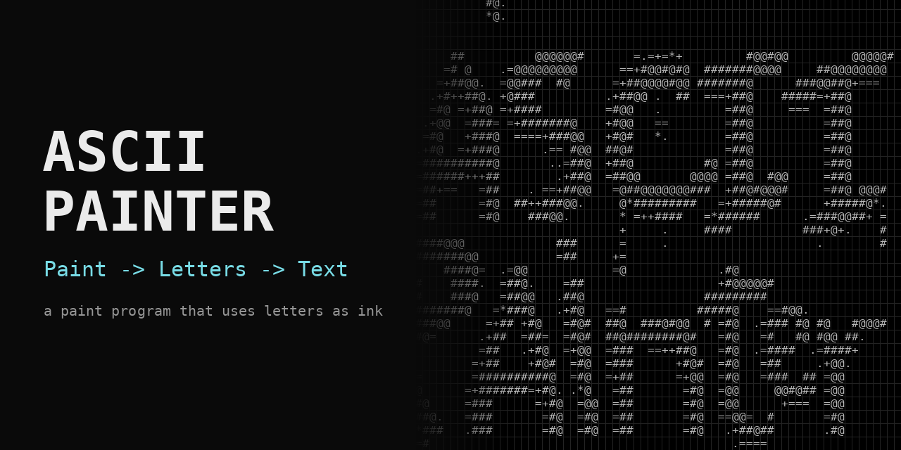
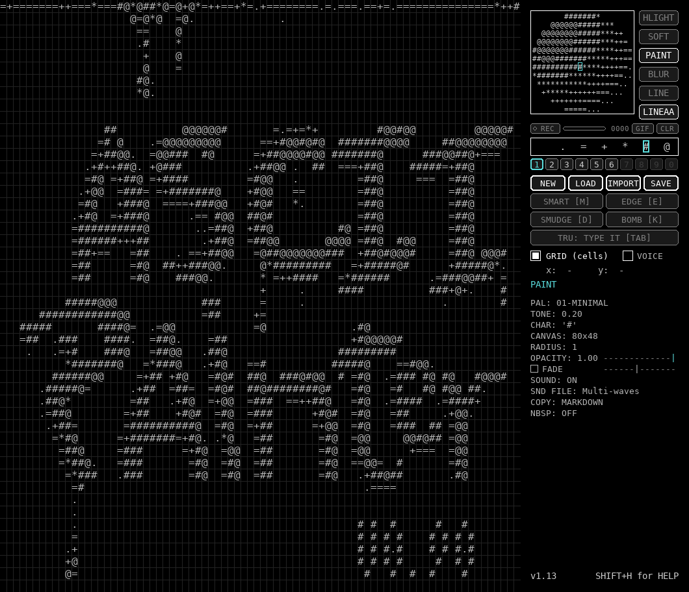
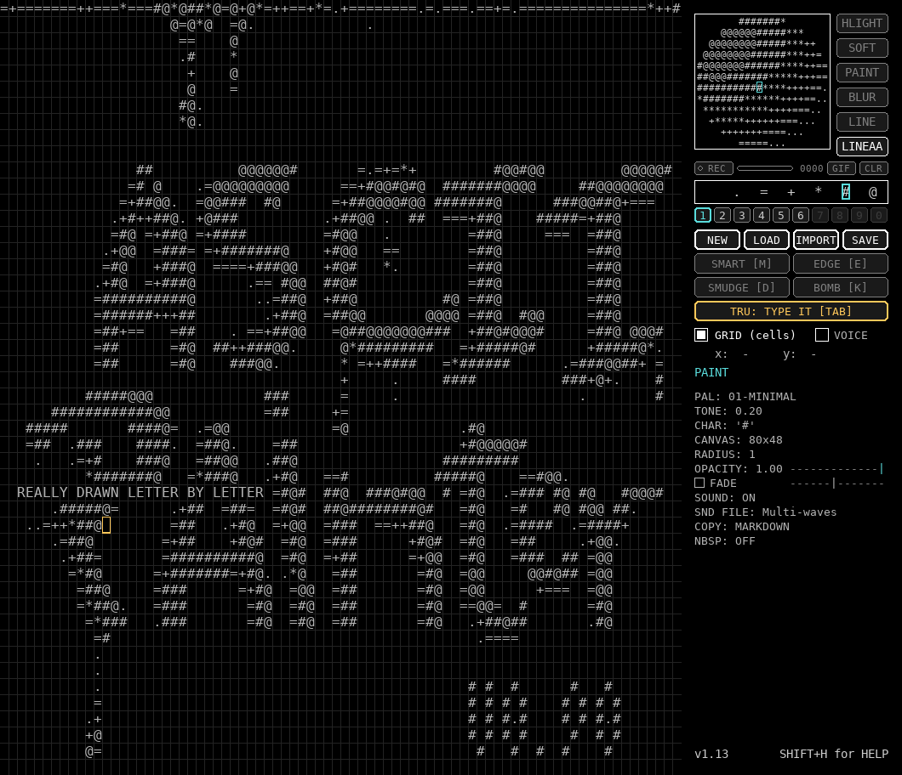
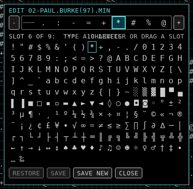
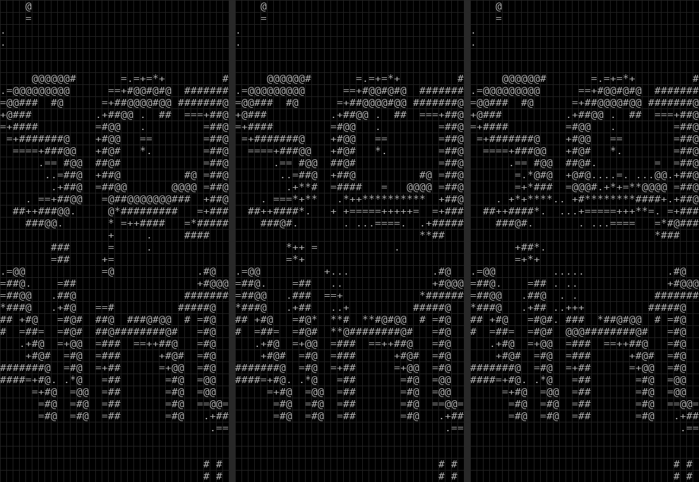
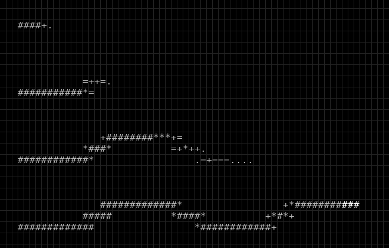

# ASCII Painter


[](https://github.com/kumodot/AsciiPainter/releases/latest)
[](https://ko-fi.com/msouza3d)



**ASCII Painter is a paint program that uses letters as ink.** You paint with brushes on a grid of monospaced characters, the palette goes from light to dark, and the result is text you can save, copy and share. The interface is ASCII too, on purpose.

---

## A note on ASCII art (please read this first)

I know this is not "real" ASCII art, and I would rather say it out loud before anyone has to tell me.

The beauty of ASCII art, just like pixel art, is that a person chooses every single pixel (or letter) on purpose, and that is exactly where the craft is. Doing that well is a real skill, and the artists who do it by hand deserve all the respect. [Vagon Parovoz](https://www.instagram.com/vagonparovoz/) is the reason this little project exists: his work made me want to play with this world. If you like what you see here, go and follow the people who make the real thing.

This app is a cheat, plainly. But the idea was never to cheat anyone out of anything. It is a toy: **a paint program that uses letters as paint instead of pigment.** It has brushes, smudge, blur, a bomb, a timelapse. You can place letters one by one, you can convert a finished image, or you can do anything in between, painting by hand with brushes. What comes out is not serious ASCII art and it does not pretend to be. It is painting with letters, for fun.

If you want to do it the hard way inside this app, there is **TRU mode**: no brushes at all, the mouse only moves a cursor and you type every character yourself, one by one.

Respect to the ones who do it the hard way. This is just my way of playing with their idea.

---

## Screenshots

| | |
|---|---|
|  |  |
| The main window: canvas on the left, tone sphere, palette bar and tools on the right. | TRU mode: type every character by hand. The line below was made with `Alt+1` to `Alt+0` (darkest to lightest shade). |
|  |  |
| The palette editor: reorder the shades, add and remove levels, pick any character. | The bomb brush: before, during and after the blast. Dense areas fade out gradually along every ray. |

---

## Run it

### Windows, ready to run
Download the latest build from [Releases](https://github.com/kumodot/AsciiPainter/releases/latest), unzip it and run `ASCII_Painter.exe`.

### Windows, from source
Double-click:
```
run_asciipaint.bat
```
It uses the `.venv` folder if there is one, installs the requirements if they are missing, and runs the newest `ASCIIPAINT_v*.py`.

### macOS / Linux, from source
```
sh run_asciipaint.sh
```
Only Windows is tested so far.

### Manually
```
pip install -r requirements.txt
python ASCIIPAINT_v113.py
```
Python 3.11 or newer is recommended (tested on 3.13).

### Build the .exe (Windows)
- `build_release.bat` makes the safe folder build (no UPX, easier on antivirus) in `releases\ASCII_Painter_v<VERSION>_build\`. Zip that folder before sharing.
- `build_onefile.bat` makes a single `.exe` in `dist\`.

Both pick the newest `ASCIIPAINT_v*.py` and read its `VERSION`. PyInstaller is installed automatically if it is missing.

---

## Features

### Drawing
- Paint with characters mapped from tone values (0.0 light to 1.0 dark). Adjustable brush radius, opacity and tone, soft edge, blur brush, and a FADE option (the stroke dies out as you draw, like a fake pen pressure).
- Modes: **Paint**, **Blur**, **Highlight** and **Line** (with or without anti-aliasing).
- **Tone sphere**: click or drag to pick a tone. Double click it to edit the palette.
- Reversible palette: `I` inverts it (light and dark swap, the darkest tone is always a space).
- Undo with `Ctrl+Z` (64 steps). NEW, LOAD and IMPORT can be undone too.

### Fade


Tick `FADE` (or press `F`) and a stroke starts at the chosen opacity and dies out as you drag, like a fake pen pressure. The slider under OPACITY sets the speed: left is a long trail, right is a short one. The four lines above use four different speeds.

### TRU mode (type every character yourself)
For people who want to draw letter by letter. Press `Tab` or click `TRU: TYPE IT`.
- No brushes: the mouse only moves a blinking cursor.
- Type any character the font can draw and it lands under the cursor. `Shift` plus a number types the shifted symbol.
- Hold `Alt` and press `1` to `0` to set the shading level of the cell under the cursor, in place, from `1` (darkest, empty) to `0` (lightest). Every press plays the keyboard click.
- Arrows, `Home`, `End`, `Enter`, `Backspace` and `Delete` work like in a text editor. `Ctrl` shortcuts (undo, save) still work. `Esc` or `Tab` leaves the mode.
- Typed text is kept when you save and load the TXT.

### Palette editor
Double click the palette bar or the tone sphere.
- The palette bar sits on top, a table of characters below. Click a slot, then click a character (or just type it) to put it there.
- `-` and `+` at the corners remove and add shading levels (3 to 24). The darkest level is always an empty space.
- Drag a character along the bar to reorder the shades.
- `RESTORE`, `SAVE` and `SAVE NEW` write to `PAL.txt`.

### Bomb
Click to light a fuse (the ring shrinks to the centre as the bomb falls). The blast spreads like a ripple, pushes the ink outward along every ray, leaves trails and a gradual void in the middle. Blast radius = brush radius, opacity = strength.

### Smart Brush and Smart Edge
A cell is a border when it has ink and touches empty background. For those cells the app picks the character of the **edge set** whose shape follows the local silhouette best (`_ , . ' j L 7 d b p S ...`). Tones are never changed by SMART EDGE, and the result is saved in the TXT, the PNG and the clipboard copies. The edge set lives in `assets/EDGES.txt` and works with every palette. Thresholds are constants at the top of the source (`EDGE_INK_MIN`, `EDGE_BG_MAX`, `EDGE_UP_THRESH`, `EDGE_MASS_W`).

### Smudge
Think of the canvas as black paint on a dark surface: the ink of a cell is `1 - tone`. SMUDGE moves ink in the direction you drag, one cell at a time. Ink is conserved: it piles up in front of the brush until cells are full, and nothing is pushed out of the canvas. Brush radius sets the size, opacity (`Shift + Wheel`) sets the force.

### Timelapse
A small row under the tone sphere: `REC` button, a bar and a number for the frames recorded, `GIF` (export) and `CLR` (wipe, click twice to confirm). `T` starts or stops recording, `Ctrl+E` exports the GIF, `Ctrl+T` wipes the frames. Frames are captured while you paint and at the end of every stroke, and skipped when nothing changed.
```python
TIMELAPSE_MAX_FRAMES = 2000    # frame limit
TIMELAPSE_GIF_FPS = 24         # playback speed
TIMELAPSE_EXPORT_SCALE = 1     # 1 = full size, below 1 downscales
TL_INTERVAL_MS = 80            # capture rate while the mouse is down
TL_START_ON = False            # start every session already recording
```

### Voice
A very raw speech synthesizer (formants, generated by code, no audio files) says the name of the brush you switch to, something funny when you enter TRU mode, something when a bomb is lit, `timelapse start`, `palette saved`, and so on. What it says is also written at the top of the canvas as yellow captions, word by word. The `VOICE` checkbox (or the `V` key) turns it off. Tunables: `VOICE_PITCH`, `VOICE_SPEED`, `VOICE_CRUSH`, `VOICE_VOL`, `VOICE_CAPTIONS`.

### Canvas, grid and overlay
- Resizable canvas: `Ctrl+Arrow` grows that side, `Ctrl+Shift+Arrow` removes empty cells. LOAD grows the canvas to fit a bigger TXT.
- Grid overlay aligned with the character cells. `Shift+O` loads an overlay image (for tracing), `O` shows or hides it.
- **IMPORT** converts an image to ASCII tones by luminance, stretched to the canvas.

### Pen pressure (Windows, optional)
When a pen touches the tablet, the pressure scales the brush opacity, size or both (`P` cycles OFF / OPACITY / SIZE / BOTH). If the sidebar says `(no pen yet)`, enable "Use Windows Ink" in the tablet driver.

### Sound
Subtle keypress sounds for strokes and UI actions. `Shift+S` turns all sound (and the voice) on and off.

---

## Shortcuts

| Key | Action |
|---|---|
| Left / Right / Middle click | paint / erase / lighten (`Ctrl` + middle = darken) |
| `Alt` + click | pick the tone under the cursor |
| `B` `L` `A` `H` `S` | blur, line, line anti-aliasing, highlight, soft edge |
| `M` / `E` / `D` / `K` | Smart Brush / Smart Edge / Smudge / Bomb |
| `Tab` | TRU mode (type every character) |
| `Alt+1` to `Alt+0` | TRU: shading level under the cursor |
| `V` | voice on / off |
| `P` | pen pressure mode |
| `-` `=` / `1`..`0` | tone darker, lighter / tone deciles |
| `Shift+1`..`0` | pick palette 1 to 10 (or click the numbered buttons) |
| Double click a character in the bar, or the tone sphere | palette editor |
| `[` `]` / wheel | brush radius (`Ctrl+Wheel` tone, `Shift+Wheel` opacity) |
| `F` | FADE on/off (slider under OPACITY: left = long trail, right = short trail) |
| `I` / `X` | invert palette / toggle darkest and lightest tone |
| `G` / `O` / `Shift+O` | grid / overlay show / load overlay |
| `T` / `Ctrl+E` / `Ctrl+T` | timelapse record / export GIF / wipe |
| `N` / `Ctrl+S` / `Ctrl+Z` | new / save TXT + PNG into `saves/` / undo |
| `Ctrl+C` | copy as Markdown code block |
| `Ctrl+Alt+C` / `Ctrl+Shift+C` | copy as HTML `<pre>` / copy fit (crop to content, resample to the columns you choose) |
| `Ctrl+Alt+S` | copy for Slack |
| `Ctrl+Shift+N` | toggle non-breaking spaces |
| `Ctrl+Arrows` / `Ctrl+Shift+Arrows` | grow canvas / remove empty edges |
| `Shift+H` | help overlay (hover any button for a second to see its shortcut) |
| `Esc` | leave line, highlight, smart, bomb or TRU mode |
| `Ctrl+Q` | quit (asks to save first) |

---

## Files the app saves and loads

- **TXT**: the drawing as plain text (what you copy and share). Characters outside the palette are kept as typed.
- **PNG**: the same drawing rendered with the font.
- **GIF**: the timelapse.
- `assets/PAL.txt`: palette definitions, light to dark, the last character of every palette is a space.
- `assets/EDGES.txt`: the edge set for Smart Brush / Smart Edge.
- `assets/startup.txt`: the drawing loaded at launch (optional).

**Your files win.** If a `PAL.txt` or `startup.txt` sits next to the script (or next to the `.exe`), it is used instead of the bundled one. The same goes for a `sounds` folder. Saves always go to a `saves` folder next to the script or the `.exe`. If the app crashes, the error is written to `crash.log` next to it.

---

## Tech notes

- Single Python file, Pygame for the window and input, NumPy for the canvas and the brushes. The canvas stores a tone per cell; the character is chosen from the palette (plus an optional forced character per cell for Smart Edge and TRU).
- Smart Edge upsamples the 3x3 tone neighbourhood to pixels and matches it against blurred glyph patterns of the edge set. Smudge advects ink per cell step with a capacity limit. The bomb plans the whole blast once (rays, trails, ripple timing) and plays it back.
- The voice is a formant synthesizer: phonemes from a small lexicon plus crude spelling rules, harmonics shaped by three formants, filtered noise for fricatives and bursts.
- Tests run without a window or a sound card:
```
pip install -r requirements.txt
python tests/smoke_test.py
```

### Configuration constants (top of the source)
```python
OVERLAY_OPACITY = 0.35    # overlay transparency (0.0 - 1.0)
TEXT_LUMA = 0.72          # default character brightness
INITIAL_BRUSH_RADIUS = 1  # starting brush radius
UNDO_LIMIT = 64           # max undo history steps
MAX_COLS = 80
ROWS_OVERRIDE = 48
CANVAS_GROW_COLS = 10     # cells per Ctrl+Left/Right
CANVAS_GROW_ROWS = 6      # cells per Ctrl+Up/Down
HELP_FONT_SIZE = 12       # Shift+H list font
```

---

## Layout

```
ASCIIPAINT_v113.py     main source (the version number is in the file name)
version.json           current version and entry file
assets/PAL.txt         palette definitions (light to dark)
assets/EDGES.txt       characters used by Smart Brush / Smart Edge for borders
assets/startup.txt     ASCII project loaded at launch (optional)
assets/sounds/         keypress_XX.wav feedback sounds (files starting with _ are ignored)
assets/icon.ico        app icon
screenshots/           README images and the share banner
docs/                  RELEASE_NOTES_vX.XX.md
tests/smoke_test.py    headless test of the main features
tools/get_version.py   helper used by the build scripts
run_asciipaint.bat/.sh launchers      build_release.bat / build_onefile.bat  exe builds
README.md  CHANGELOG.md  LICENSE  .gitignore  .gitattributes
```

---

## Support

If you like it, you can [buy me a coffee](https://ko-fi.com/msouza3d). Thanks for using the app.
If you are from Brazil you can send a donation using the PIX QR Code:<br>


## License

Released under the **MIT License** (see `LICENSE`). Feel free to modify, remix and share.

Created by **Marcelo Souza (@msouza3d)**. Inspired by the work of [Vagon Parovoz](https://www.instagram.com/vagonparovoz/) and the ASCII / ANSI art community.
